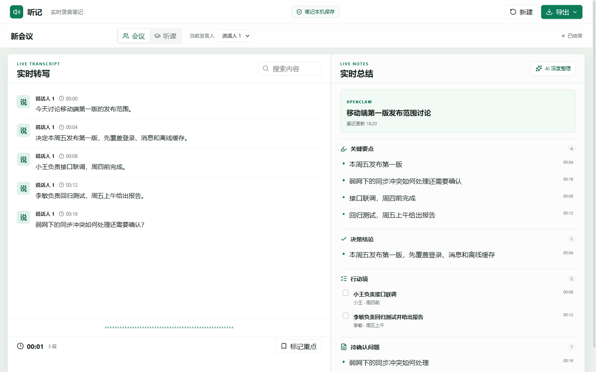
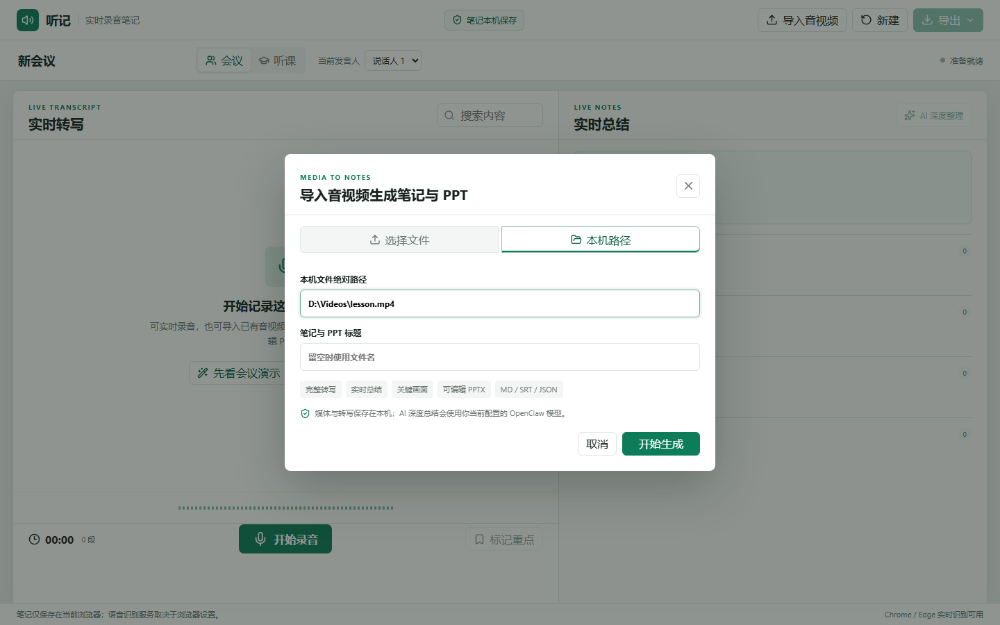

# 听记 Live Notes

面向会议和听课场景的实时录音转写、音视频速读与结构化笔记工具。既能录音时同步整理，也能导入已有音频/视频，在后台生成完整转写、导读、脑图、笔记、关键画面与两类 PowerPoint。





## 核心能力

- Chrome / Edge 连续实时转写，支持麦克风、电脑声音以及两者混合，保留原始录音并支持暂停、继续、结束。
- 会议与听课双模板：决策、负责人、截止时间、待确认问题；知识点、例子和复习问题。
- 三种总结方式：无需模型的纯代码整理、直连常用模型 API、本机 OpenClaw；模型不可用时自动降级且不丢已提取事实。
- 每条摘要关联转写时间戳，可点击回到对应文本或录音位置。
- 手动切换发言人、标记重点、全文搜索、异常会话恢复。
- 导出 Word、PDF、Markdown、PowerPoint、TXT、SRT、JSON 和原始 WebM 录音。
- 导入 MP4、MKV、MOV、WebM、MP3、WAV、M4A、AAC、FLAC、OGG，最大 4 GB。
- `faster-whisper` 本地长文件转写，处理时持续回传片段和阶段摘要。
- 视频按内容时间轴提取章节画面，生成可编辑 PPTX；章节完整原文写入演讲者备注。
- 音视频速读提供“导读 / 脑图 / 笔记”三页签，以及章节速览、发言总结、要点回顾、待办事项和提取 PPT。
- 生成与主流速读产品一致的五件套：`_原文.docx`、`_导读.docx`、`_笔记.docx`、`_PPT.pptx`、`_思维导图.xmind`。
- “提取 PPT”按约 45 秒提取视频画面并写入对应逐字稿备注；原有“可编辑总结 PPT”继续用于汇报和二次编辑。
- 本机绝对路径直读模式不重复上传大文件，适合本地长录屏。
- 响应式双栏/单栏界面，桌面会议与移动记录都可用。

功能基线参考了[通义听悟](https://tingwu.aliyun.com/)的实时转写与章节/待办、[讯飞听见](https://www.iflyrec.com/html/products/apiv1.html)的角色/术语与学习整理，以及[飞书妙记](https://www.feishu.cn/product/minutes)的时间轴、结构化纪要和行动项。这里的“Top 3 基线”指三类头部产品共同能力覆盖，不代表未经统一语料评测的准确率排名。

## 快速开始

要求 Node.js 20+，推荐 Chrome 或 Edge。实时录音只需要 Node.js；音视频导入还需要 FFmpeg、Python 3.10+ 和 `faster-whisper`。

```powershell
npm install
python -m pip install -r requirements-media.txt
npm run build
npm start
```

打开 `http://127.0.0.1:8787`。也可以直接运行：

```powershell
powershell -ExecutionPolicy Bypass -File .\scripts\start.ps1
```

停止后台服务：

```powershell
powershell -ExecutionPolicy Bypass -File .\scripts\stop.ps1
```

## 实时采集电脑声音

在页面的“声音来源”中选择“电脑声音”或“麦克风和电脑声音”，点击“开始录音”后，在浏览器共享窗口中选择正在播放视频、语音或腾讯会议的标签页/屏幕，并勾选“共享音频”。应用会将声音按约 12 秒分块交给本机 `faster-whisper`，持续更新转写与总结。

> 浏览器的共享选择窗口属于系统权限界面，必须由使用者本人确认。腾讯会议若无法直接共享应用音频，可共享整个屏幕并启用系统音频，具体能力取决于 Windows、会议客户端和 Chrome/Edge 版本。

## 三种总结方式

- **纯代码**：默认选项，无需 API Key、模型或 OpenClaw，使用本地规则持续提取要点、决定、行动项和复习问题。
- **配置模型**：可选通义千问、DeepSeek、智谱 GLM、Kimi、OpenAI、Claude 或自定义 OpenAI 兼容接口。模型名和接口地址均可修改，API Key 仅保留在当前页面内存，不写入 `localStorage`、任务状态或导出文档。
- **OpenClaw**：复用本机 OpenClaw 的代理和模型配置。应用会自动寻找当前 Node 安装目录下的 `node_modules/openclaw/openclaw.mjs`，也可用环境变量覆盖入口。

### OpenClaw 配置

应用会自动寻找当前 Node 安装目录下的 `node_modules/openclaw/openclaw.mjs`，调用 `architect` 代理进行深度总结。可用环境变量覆盖入口：

```powershell
$env:OPENCLAW_ENTRY = 'D:\path\to\openclaw.mjs'
npm start
```

没有安装 OpenClaw、模型不可用或返回格式异常时，接口自动使用本地规则摘要，录音和实时转写不受影响。

## 音视频速读与多格式成果

1. 打开页面后选择“会议”或“听课”，点击右上角“音视频速读”。
2. 普通文件用“选择文件”；数百 MB 的本机素材优先用“本机路径”，服务端直接读取，不再复制一份。
3. 页面会依次显示读取媒体、提取音轨、本地转写、结构化总结、提取画面和生成 PPT 的进度。转写段落和本地摘要会在处理中持续出现。
4. 完成后可在右侧切换“导读 / 脑图 / 笔记”；章节、复习题和提取画面均可点击跳回原视频时间点。
5. 从“导出”下载原文 Word、导读 Word、笔记 Word、提取画面 PPT、XMind 脑图，以及原有 Word、PDF、Markdown、可编辑总结 PPT、TXT、SRT、JSON 和原始音视频。

已有任务升级后可复用原转写，补生成速读成果而无需重新跑 Whisper：

```powershell
npm run regenerate:speed-read -- <任务ID>
```

默认模型为 `small`，CPU 使用 `int8` 推理。可按需要切换精度或语言：

```powershell
$env:LIVE_NOTES_WHISPER_MODEL = 'medium'
$env:LIVE_NOTES_LANGUAGE = 'zh' # 或 auto
$env:LIVE_NOTES_INITIAL_PROMPT = '宝武、智能体、知识库、工作流' # 可选术语提示
$env:LIVE_NOTES_PYTHON = 'D:\Python\python.exe'
npm start
```

## 隐私说明

- 会话文本和摘要默认保存在当前浏览器 `localStorage`，服务端不持久化。
- 录音仅保留为当前页面内的 Blob，刷新后不会上传或恢复。
- 浏览器语音识别可能使用浏览器厂商的在线服务，行为取决于浏览器和系统设置；敏感会议请先确认组织政策。
- 选择直连模型或 OpenClaw 时，转写文本会发送给对应模型供应商；纯代码模式不会调用外部总结接口。
- 导入媒体保存在本机 `output/`，不会随 Git 提交。音轨只用于转写，处理完成后自动删除；视频关键帧和导出成果保留在对应任务目录。

## 验证

```powershell
npm test
npm run lint
npm run build
```

当前自动化覆盖摘要去重、会议/课堂提取、暂停恢复、WAV 重采样、Word/PDF/Markdown/PPT 导出、速读五件套、XMind 结构、笔记保存、媒体任务增量状态、章节规划、HTTP 校验、三种总结后端与本地降级。浏览器验收覆盖三种总结方式、三种声源、导入弹窗、真实任务恢复、导读/脑图/笔记、全部导出格式及桌面和移动布局。

## 已知边界

- 浏览器原生实时识别的语言与准确率由 Chrome / Edge 服务决定，嘈杂环境和方言需要接入专业 ASR 才能与商业引擎做公平比较。
- 当前提供手动发言人切换，不包含声纹级自动分离。
- 音视频导入目前统一标记为“讲者”或“说话人 1”，尚未做自动说话人分离。
- 首次使用某个 Whisper 模型时会从 Hugging Face 下载模型；`small` 约需数百 MB，之后复用本机缓存。
- 首版是单机工具，不含账号、云同步和多人协作。
